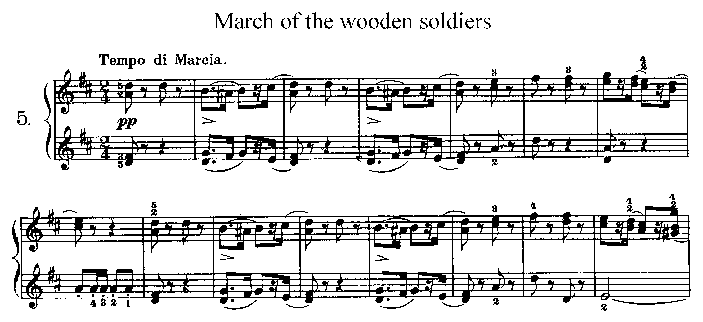
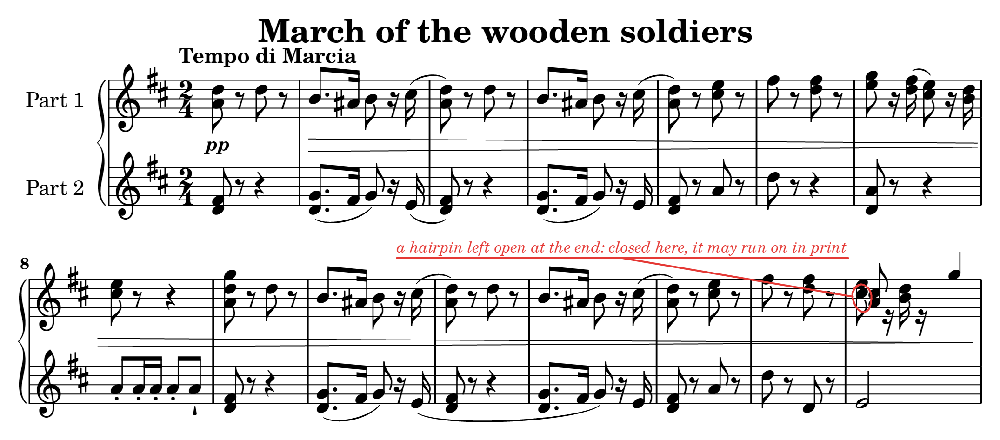
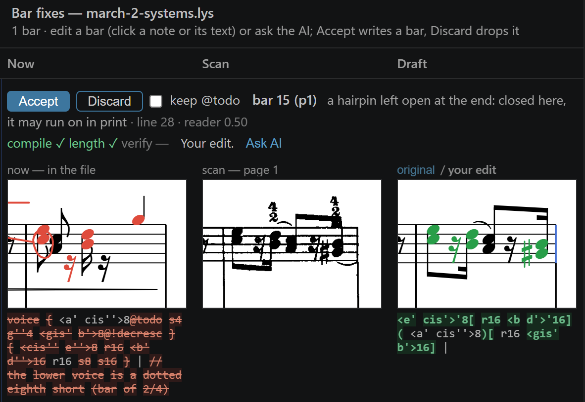

# Copista (LilySharp-Omr)

Optical music recognition for [Lily#](https://yotsuda.github.io/LilySharp/): reads a page image or
a PDF of printed sheet music and writes editable Lily# text (`.lys`), with the places it is unsure
of marked for a look. The reading runs on your computer: a small learnt symbol detector (ONNX), the
rules of notation and Windows' own text recognition read the page; the reader sends nothing
anywhere and uses no large language model. (Lily#'s optional *Fix OMR Marks with AI…* sends the
marked bars to the language model you choose in VS Code.)





*Above: Tchaikovsky, Album for the Young, Op. 39 No. 5, G. Schirmer 1904 (public domain, from
IMSLP). Below: the reader's `.lys` for the same bars, drawn by Lily#. Red marks the place it asks
you to check: the last bar of the right hand, read wrong.*



*Correcting that marked bar (bar 15 of the right hand) in Lily#: the bar as read (left) opens
beside the same bar on the scan (middle), and the draft (right) is edited by hand or with an AI
model; it shows whether it compiles, fills its bar and matches the scan before Accept writes it.*

## Use it

The reader ships as the VS Code extension
[**Copista**](https://marketplace.visualstudio.com/items?itemName=yotsuda.copista)
(Beta, Windows x64), which works with the
[Lily#](https://marketplace.visualstudio.com/items?itemName=yotsuda.lilysharp) extension: right-click
an image or a PDF and choose *Convert Image/PDF to Lily# (.lys)… (Beta)*. The extension's
[README](extension/README.md) says what it reads, what it does not yet, and how to correct a
reading against the scan.

What it reads, in short: staves and groups of staves, clefs, key and time signatures, notes, chords,
rests, dots, accidentals, beams, tuplets, ties and slurs, grace notes, several voices on a staff,
multi-bar rests and percent repeats, tremolos, octave lines, guitar and bass TAB, drums, dynamics,
hairpins, pedal marks, articulations and ornaments, trills, arpeggios, glissandi, repeats and
endings, common words of expression, the tempo, the title, composer and poet, rehearsal marks, and
the lyrics of songs, verse by verse (better on clean pages than on old scans).
Not yet: chord names, handwritten music.

## What it is built for

The reader makes a text you will check and finish, not a guess you have to trust. Its learnt
part is asked a different question from that of a reader that reads a staff end to end:

| | This reader | A reader that reads a staff end to end |
|---|---|---|
| What the model is asked | What symbol is here? | What music is written on this staff? |
| How | A small convolutional network (CenterNet-like, with no box sizes): the page is scaled to 16 pixels a staff space and read in bands 14 spaces tall, with a heat map per kind of symbol (95 kinds), each peak one symbol | A staff is cut out, and a sequence model writes out its symbols (pitches, values…) one token after another |
| Where the staves are | Found by the rules; the detector does not know where they are | Found first, so that each staff can be cut out for the model |
| What comes out | Symbols with their kind, place on the page and confidence, in no order | The music in order, with the staff's place on the page but not each symbol's |
| What it looks at | About 8 staff spaces around each symbol | The whole staff, the context before and after |
| Knowledge of music | No melody or harmony in the model, only what shows within a few spaces; the rules put chords, voices and bars together and check them | In the model: it learns how music usually goes |
| Bars | Each bar has its place on the page, and the bars read are counted against the printed bar numbers | A bar missed shifts every bar after it |
| When it is wrong | A bar that does not fill is marked: a wrong reading tends to look wrong | The model writes what music usually does, so a wrong reading can look right |
| Putting a kind of mistake right | Traced to the detector or to a rule; a rule put right mends every bar it touches | It lies in the weights: more data, and the model learnt again |
| A new kind of symbol | Easy to add: pieces that have it are drawn, and the detector is learnt again in under an hour, the rest of its data as it was. But what it means in the music is a rule written by hand | New tokens, and the whole model learnt again on transcriptions that spell the symbol, a long run. But no rule to write: the model learns what it means |
| The model | About 1.2 million weights, a 5 MB file | Tens of times larger |
| Speed | A page in about ten seconds on the CPU; no GPU | Runs on the CPU too, a GPU optional; several times as long a page |
| Learning again | Under an hour on one desktop GPU, so a change can be tried and measured the same day | Days on a GPU, on larger data |
| What to install | The VS Code extension alone: no Python, nothing more to download | Usually Python with its packages, and the models |
| Where it runs | Windows x64 only | Usually Linux, macOS and Windows |

What follows from it:

- **Every symbol has its place on the page.** A detector finds each head, rest, accidental
  and mark where it is printed, and the rules of notation put them together. So the reader
  can box what it doubts, open a bar beside the scan, and draw its own reading again to
  compare it with the page (`--verify`). A reader that turns a whole staff into a string of
  symbols at once can tell only roughly where each one came from.
- **It writes what it sees, and shows where that does not add up.** Bars are checked against
  the time signature and voices against each other; a bar that does not fill is marked, not
  filled with what the music would most likely do. A wrong reading tends to look wrong.
- **The whole score, not only pitches and rhythms.** Dynamics, hairpins, articulations,
  ornaments, pedal marks, words of expression, the tempo and the title are read where they
  stand on the page. A new kind of symbol is taught by drawing pieces that have it, so the
  reader grows one symbol at a time.
- **Small and local.** A 5 MB detector and the rules, on the CPU: no GPU, nothing sent
  anywhere. The code and the model are under the Apache License 2.0. The model learnt from
  pages the project draws itself, from music it makes up, and from public-domain scans of
  songs whose notes are CC0: no non-commercial or share-alike data went into it.
- **Measured on music it never learnt from.** The evaluation pieces are kept out of
  training: neither their pages nor their notes were seen.

Where it is behind: old prints scanned small or worn, where a reader trained end to end on
heavily degraded pages still reads more notes. That gap is the current work. And it runs only on
Windows x64.

## How sure it is, symbol by symbol

Every symbol the detector finds comes with a score, the height of its peak, and stands at its place
on the page. The rules weigh those scores as they put the music together, and add what they find
themselves: a head the detector barely sees, a dot the rules found and the detector does not, a bar
whose voices do not fill its time, a bar that draws differently from the page (`--verify`). Each
such place becomes a todo with a confidence from 0 to 1 and a box on the page
([docs/protocol.md](docs/protocol.md) says how each is set). The less sure ones are written into the
`.lys`; Lily# boxes them on the scan, opens the bar beside the page, and *Fix OMR Marks with AI…*
sends only those bars to an AI. So the work of checking goes where the reading is weak, not over
every bar.

A reader that writes a staff out as tokens has a probability for each token too, but not the place
on the page it came from, and its sense of how music usually goes can make a wrong reading look as
sure as a right one. The marks here are not a proof either: they catch most of the bars read wrong,
not all of them.

The same design keeps the reader from leaning towards a kind of music. The detector learns what
symbols look like, not how music goes: it sees a few staff spaces around each symbol, and the pieces
it learnt from are mostly music the project makes up. What it reads depends on the symbols it has
been taught (TAB and drums, not yet chord names), not on the style of the music; a reader
that learns how music goes reads best the kind of music it learnt from.

## What it writes

Most readers write MusicXML, the format notation programs exchange, made for programs rather than
for people, or a MIDI file, which keeps the notes to play and loses most of the notation. This one writes Lily# text, a bar to a line:

```
  p1 {
    b8. b'16@text("espressivo") |
    b'2. c''4 |
    …
    gis4@todo(b10-up "⅙ halves short of 2/2: a note or rest missed, or a duration misread?") tuplet 3/2 { a8@cresc b8@!cresc } d'8@decresc c'8 e8@!decresc <a e'>8 |
```

- **Short enough to read and correct by hand**, and to compare in version control.
- **The doubt travels with the music.** A place to check is marked on its note in the text
  (`@todo`), with what does not add up, so Lily#, a person and an AI model all see it where it is.
  MusicXML has no place for how sure a reading is: a reader can only colour a note, which says
  neither how sure nor why, or keep its doubts in a file of its own that no notation program draws.
- **Beside it, `x.omr.json`** holds where each bar is on the page and every todo with its
  confidence, for a program that calls the reader ([docs/protocol.md](docs/protocol.md)).
- **MusicXML when you need it.** Lily# turns the `.lys` into MusicXML (`lysc xml`), MIDI, LilyPond
  source or PDF; the marks stay in the `.lys`.

## How well it reads

The evaluation sets are 66 readings of piano pieces and songs, some of them the same music in
different editions, that the reader is never tuned on; all are public domain or under a free
license (`data/eval`; the numbers are in [docs/eval-sets.tsv](docs/eval-sets.tsv); three editions
are downloaded by hand, see [data/LICENSES.md](data/LICENSES.md)). A note or rest counts when its
pitch and duration match the truth. Other songs from some of the same old prints are in the
development set (`data/dev`), whose scans the detector learns from.

| Pages | Sets | Notes and rests | Read right |
|---|---|---|---|
| Engraved with MuseScore (OpenScore Lieder) | 31 | 25,605 | 96.7% |
| Engraved with LilyPond (Mutopia) | 8 | 2,959 | 94.1% |
| Other modern engravings (Dorico, abcm2ps and others, from IMSLP) | 7 | 2,374 | 93.2% |
| Scans of 19th- and early 20th-century prints (IMSLP) | 20 | 27,333 | 91.5% |
| All | 66 | 58,271 | 94.0% |

A page reads in about ten seconds on the CPU; an old print scanned small, or a long PDF, takes
longer. The marks are not a proof: a bar with no mark can still be wrong.

## Build and run

Needs Windows 10 version 2004 (build 19041) or later, x64, and the .NET 10 SDK.

```
dotnet build src/Omr -c Release
src\Omr\bin\Release\net10.0-windows10.0.19041.0\omr.exe read data\eval\chopin28-4\src\Chop-28-4a-a4.pdf --out out\try
```

`omr read` takes PNG, JPEG, BMP, TIFF and PDF pages of one piece, in order, and writes `x.lys`,
`x.omr.json` (where each bar is on the page, and the todos) and `x.omr-pNN.png` (the pages with the
marks boxed). `--verify` draws the `.lys` again and checks it against the pages bar by bar; it
needs `lysc`, Lily#'s command line compiler, on the PATH or given with `--lysc` (it is built from
the [Lily# repository](https://github.com/yotsuda/LilySharp), and the Lily# extension carries one).
`omr --version --json` says what this build can do.

How the reading goes in more detail: [docs/reader.md](docs/reader.md) (voices, words over the
music, braces and brackets). What `omr read` and `omr verify` write and print, for a program that
calls them: [docs/protocol.md](docs/protocol.md).

## The repository

| Folder | What is in it |
|---|---|
| `src/Omr` | the reader (`omr.exe`) |
| `src/OmrGen` | the generator of pieces with their truth, drawn by Lily#, for training and testing |
| `src/OmrDegrade` | makes a clean page look printed and scanned |
| `tools` | the regression gate (`check.ps1`), the runs of each set, packing the extension; `train-model/` trains the detector (Python 3.12, PyTorch with CUDA; see its `requirements.txt`) |
| `data` | the evaluation and development sets, the detector (`detector.onnx`) and its tables |
| `extension` | the VS Code extension that carries the reader |
| `docs` | the development log: [ROADMAP.md](docs/ROADMAP.md) and [HANDOFF.md](docs/HANDOFF.md) (in Japanese), the notes exchanged with Lily# (`docs/repro`) |

`tools/check.ps1` is the regression gate: the generated sets and the real benchmarks against
`docs/baseline.json` (`-Detector`: `docs/baseline-detector.json`). The tools that turn the
evaluation PDFs into pages use PyMuPDF (AGPL-3.0).

## Contributing

The most useful help is a page the reader gets wrong: please open an issue with the page (one you
may share), what it wrote and what the page says. See [CONTRIBUTING.md](CONTRIBUTING.md).

## License

The code is under the [Apache License 2.0](LICENSE) (see also [NOTICE](NOTICE)). The data under
`data/` keeps the licenses of its sources: public domain, CC0, CC BY 4.0, and LilyPond's GPL for
the `event-listener*.ly` files; [data/LICENSES.md](data/LICENSES.md) lists each.
